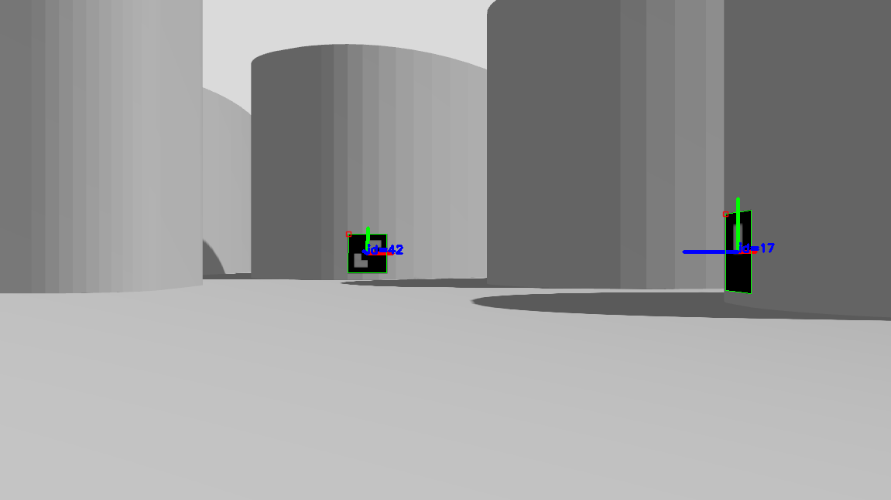
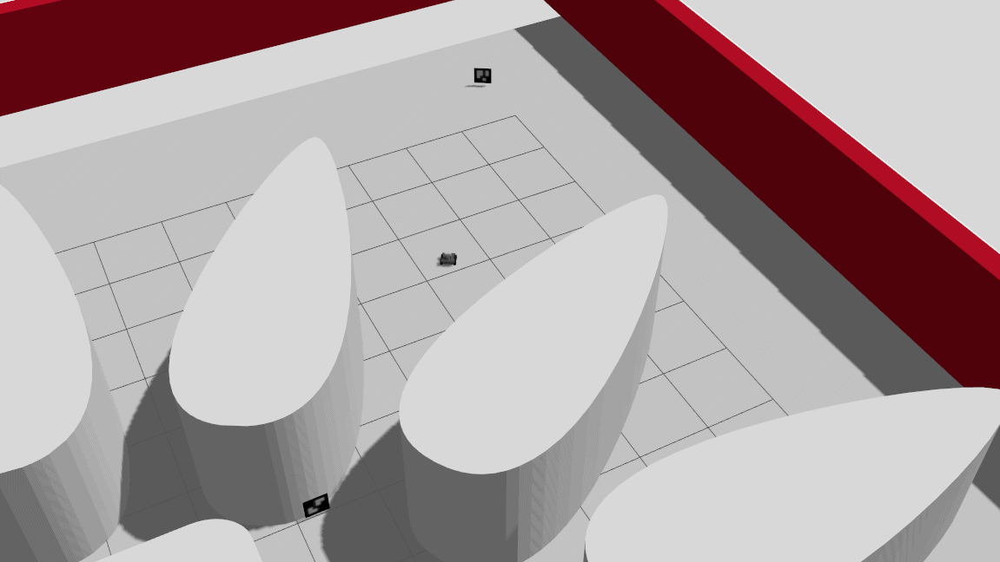

# Autonomous Mobile Robot Patrol & Dynamic ArUco Marker Inspection

A ROS 2 and Nav2 autonomous navigation project featuring the **Husarion ROSbot 3** in Gazebo. The robot continuously patrols a predefined trail of waypoints while running real-time OpenCV ArUco fiducial marker detection and 3D pose estimation. When an unvisited marker enters the camera's field of view, the robot dynamically interrupts its patrol, computes a normal standoff pose in the global `map` frame, approaches the marker to inspect it for a set duration, and seamlessly resumes its patrol route.

---

## Demonstrations

| Onboard Camera View (`Aruco View`) | Top-Down Approach View (Gazebo / RViz2) |
| :---: | :---: |
|  |  |

---

## Task Overview

* **Autonomous Waypoint Patrol:** Uses `nav2_simple_commander` (`BasicNavigator`) to cycle through a 6-waypoint patrol loop across the mapped environment.
* **Real-Time 6-DOF ArUco Pose Estimation:** Detects `DICT_4X4_50` fiducial markers from the onboard Luxonis OAK-D RGB stream (`/oak/rgb/color`), estimates their 3D translation and rotation vectors (`tvecs`, `rvecs`), and transforms the poses from `oak_rgb_camera_optical_frame` into the global `map` frame via `tf2`.
* **Normal Vector Standoff Calculation:** Extracts the marker's surface normal from its rotation matrix to calculate an exact standoff goal at `stop_distance` ($1.0\text{ m}$ by default) directly in front of the wall, oriented to face the marker head-on.
* **Finite State Machine (FSM) Interruption & Recovery:**
  * Dynamically cancels active Nav2 patrol goals upon discovering a new marker within range ($< 10.0\text{ m}$).
  * Continuously refines the standoff goal pose if the marker's estimated position shifts by more than `recalculation_distance` ($0.3\text{ m}$) during the approach, or redirects to a closer marker if one is spotted mid-approach.
  * Tracks visited marker coordinates to prevent redundant inspections until the full patrol loop resets.
* **Procedural Gazebo Marker Generation:** Includes a utility script to automatically generate custom ArUco textures, SDF models, and material configurations for simulation.

---

## System Architecture

### 1. `aruco_patroller.py` (`ArucoPatroller`)
The central decision-making node operating a 4-state Finite State Machine (`PATROLLING`, `CANCELING_PATROL`, `APPROACHING_MARKER`, `WAITING_AT_MARKER`):
* Subscribes to `/detected_marker_pose` (`geometry_msgs/msg/PoseStamped`) and `/amcl_pose` (`geometry_msgs/msg/PoseWithCovarianceStamped`).
* Computes the approach pose $(x_t, y_t, \theta_t)$ from the marker's position $(m_x, m_y)$ and surface normal $(n_x, n_y)$:
  $$x_t = m_x + d_{\text{stop}} \cdot n_x, \quad y_t = m_y + d_{\text{stop}} \cdot n_y, \quad \theta_t = \text{atan2}(-n_y, -n_x)$$
* Holds position in front of the marker for `wait_time` ($2.0\text{ s}$) before returning to the interrupted patrol waypoint.

### 2. `aruco_pose_detector.py` (`ArucoPoseDetector`)
* Subscribes to `/oak/rgb/color` and `/oak/rgb/camera_info` using a `BEST_EFFORT` QoS profile.
* Runs `cv2.aruco.detectMarkers` and `cv2.aruco.estimatePoseSingleMarkers` (configured for a physical marker size of $0.3\text{ m}$).
* Converts Rodrigues rotation vectors into quaternions, transforms the `PoseStamped` message to the `map` frame using `tf2_ros`, publishes to `/detected_marker_pose`, and renders live 3D coordinate axes in an OpenCV debug window (`Aruco View`).

### 3. Supporting Utilities
* **`generate_aruco_models.py`:** Procedurally generates Gazebo SDF models, `model.config` files, and PNG textures for any list of `DICT_4X4_50` marker IDs.
* **`waypoint_navigator.py`:** Standalone baseline patrol script for sequential waypoint navigation without marker interruption.
* **`aruco_detector.py` / `aruco_detection_simple.py` / `aruco_pose_est_simple.py`:** Standalone debugging nodes and scripts for testing 2D marker detection and camera-frame 3D pose estimation.

---

## Build Instructions

1. Install required system and ROS 2 dependencies:
   ```bash
   sudo apt-get update
   sudo apt-get install python3-pip ros-dev-tools python3-pyudev
   export PIP_BREAK_SYSTEM_PACKAGES=1
   rosdep update --rosdistro $ROS_DISTRO
   rosdep install -i --from-path src --rosdistro $ROS_DISTRO -y
   ```

2. Build the workspace for Gazebo simulation:
   ```bash
   export HUSARION_ROS_BUILD=simulation
   colcon build --symlink-install
   source install/setup.bash
   ```

---

## Usage Instructions

Run each of the following commands in a separate terminal (ensuring `source install/setup.bash` has been run in each):

### 1. Launch the Gazebo Simulation
Starts Gazebo and spawns the Husarion ROSbot 3 model:
```bash
ros2 launch rosbot_gazebo simulation.launch.py robot_model:=rosbot use_sim_time:=True
```

### 2. Launch Nav2 Localization & Navigation
Loads the pre-built occupancy grid map and initializes AMCL and the Nav2 stack:
```bash
ros2 launch rosbot3_nav navigation.launch.py map:=$(ros2 pkg prefix rosbot3_nav)/share/rosbot3_nav/maps/map.yaml use_sim_time:=True
```
*(Note: If your map is stored in your source tree, pass the path directly, e.g., `map:=/path/to/src/rosbot3_nav/maps/map.yaml`)*

### 3. Launch Marker Spawner, Detector & Autonomous Patroller
Spawns the ArUco markers in Gazebo, starts the OpenCV pose estimation node, and initiates the autonomous patrol FSM:
```bash
ros2 launch amr_lv4 lv.launch.py
```

### Monitoring & Debugging
To inspect the global `map`-frame coordinates of detected ArUco markers in real time:
```bash
ros2 topic echo /detected_marker_pose
```

---

## Configurable Parameters

| Node | Parameter | Default | Description |
| :--- | :--- | :--- | :--- |
| `aruco_patroller` | `stop_distance` | `1.0` | Standoff distance (m) along the marker's surface normal |
| `aruco_patroller` | `wait_time` | `2.0` | Inspection duration (s) once positioned in front of a marker |
| `aruco_patroller` | `recalculation_distance` | `0.3` | Position drift threshold (m) to trigger goal pose refinement |
| `aruco_patroller` | `decision_timeout` | `10.0` | Time window (s) allowing redirection to a newly spotted closer marker |
| `aruco_pose_detector` | `marker_size` | `0.3` | Physical edge length (m) of the ArUco markers |
| `aruco_pose_detector` | `camera_topic` | `/oak/rgb/color` | RGB image topic subscribed for marker detection |